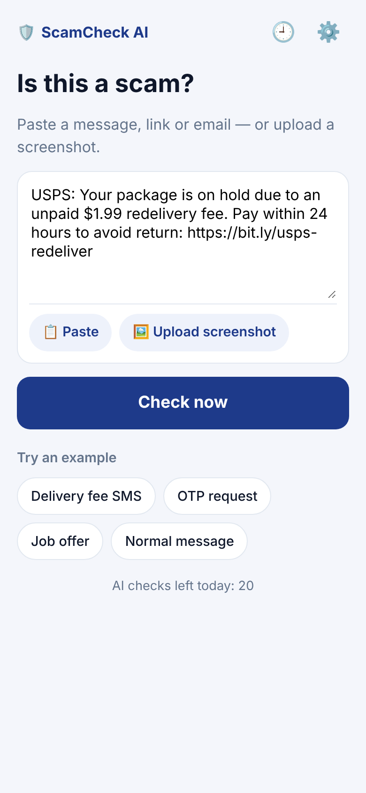
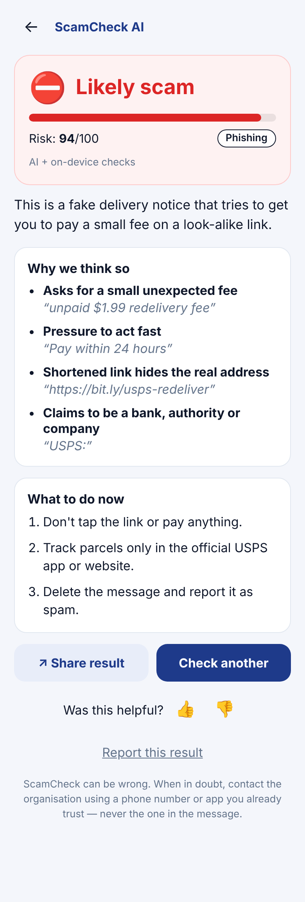
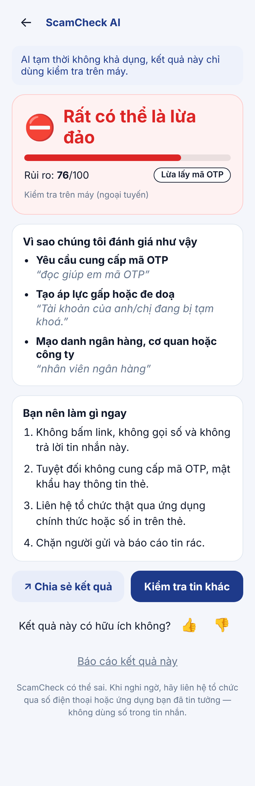
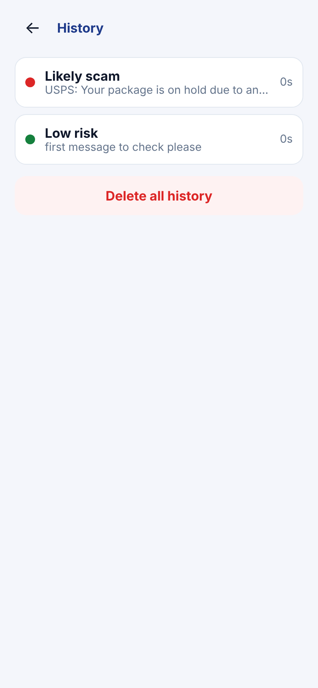

# ScamCheck AI 🛡️

**Paste it, share it, or screenshot it, and know in about 5 seconds whether it's a scam.**

ScamCheck AI is an Android app for anyone who gets suspicious texts, emails, chat messages or links.
Share a message from any app, paste it, or upload a screenshot. You get a clear verdict
(**Likely scam / Suspicious / Low risk**), the red flags quoted from the message, and concrete next steps.
Claude analyses the message. On-device rules work offline and act as a safety net, so the app always
gives an answer and leans towards caution. Available in English and Vietnamese. Free with ads.

> ENG201 Product Development, Fulbright University Vietnam × Apero — AI-native app build, Fall 2026.

| Home | Result | Offline (VI) | History |
|---|---|---|---|
|  |  |  |  |

**Live AI backend:** `https://scamcheck-api.hangocminhthong.workers.dev` (health: `/health`)
**Android APK:** GitHub → Actions → latest "Test & build Android APK" run → artifact `scamcheck-ai-debug-apk`
**Demo video (2–3 min):** _ADD LINK HERE_ (script: [docs/demo-video-script.md](docs/demo-video-script.md))

---

## 1. Problem
- **57%** of adults worldwide experienced a scam in the past 12 months and **23% lost money**, an estimated
  **US$442B** in total. Yet **73%** believe they can recognise a scam (GASA & Feedzai, *Global State of Scams 2025*,
  n = 46,000 adults in 42 markets).
- In Southeast Asia, scammers took **US$23.6B**, and **Vietnam has the region's highest share of adults
  targeted (77%)**. People mostly verify with weak rules of thumb such as "too good to be true" (32%), and only
  22% recovered any money (GASA, *State of Scams in Southeast Asia 2025*).
- Today people ask a relative, Google the number, or guess. Built-in filters (Google Messages, Truecaller)
  cover SMS and calls only, give no explanation, and miss Zalo, WhatsApp, email and marketplace chats.

## 2. Target users
- **Primary:** adults aged 25–60 who get several unsolicited messages a week: delivery notices, "bank" or
  "police" messages, job offers, prizes, marketplace buyers. Their job to be done: *"When a message asks me to
  click, pay or share a code, help me decide quickly whether it's safe, so I don't lose money."*
- **Secondary:** adult children protecting their parents (they install the app for them and share results).
- Launch markets: global English speakers, plus Vietnam (full Vietnamese UI and Vietnamese scam patterns).

## 3. Core features (v1.0)
| | Feature |
|---|---|
| 🔍 | **Check text or links.** Paste, or tap an example. |
| 📤 | **Share-sheet check.** Share a message from Messages, Zalo or Gmail → "Check with ScamCheck" → auto-check. |
| 🖼️ | **Screenshot check.** Claude reads the image; no OCR library needed. |
| ⚖️ | **Hybrid verdict.** Claude + 14 on-device rule families (urgency, OTP requests, money requests, impersonation, look-alike, shortened and risky links, APK/remote-access…). The higher risk wins. |
| 📋 | **Explained result.** Risk meter, scam type, red flags with quoted evidence, "what to do now", disclaimer. The app never says "100% safe". |
| 📴 | **Works offline.** On-device check, clearly labelled. |
| 🚩 | **Feedback + in-app report** (Google Play AI-generated content policy). |
| 🕘 | **History** on the device only, deletable. |
| 🌐 | **English / Tiếng Việt.** |
| 📊 | **Event tracking** (Firebase) without message content. See [TRACKING_PLAN.md](TRACKING_PLAN.md). |

## 4. Launch channel and business model
- **Channel:** Google Play, published by Apero. The same build runs as a web app for demos.
- **Revenue v1:** an AdMob adaptive banner on the result screen. No interstitials, to protect trust in a safety app.
- **Cost control:** 20 free AI checks per device per day. After that, on-device checks only. One Claude
  Haiku call per check, max 900 output tokens.
- **Revenue v2 (validated first):** *ScamCheck Pro* (unlimited AI checks, deep link scan, family alerts, no ads).
  v1 ships a clearly labelled **"Coming soon → Notify me"** fake door. It measures willingness to pay
  (`pro_waitlist_joined ÷ pro_cta_viewed`) before we build billing. See [ADR 005](wiki/decisions/005-fake-door-pro.md).
- **Growth:** users share results to warn family members, the share sheet makes repeat use easy, and the app
  can be cross-promoted from Apero's *Caller ID & Call Protect* (55M+ downloads).

## 5. How to build, run and access

### Repository layout (Apero wiki + harness)
```
CLAUDE.md          rules for Claude
raw/               source material (brief, market research) — never edited
wiki/              the spec: overview, features (with "Done when"), screens, decisions (ADRs), log, learned
app/               the product: React + TypeScript (Vite), Capacitor 8 Android project in app/android
worker/            Cloudflare Worker: holds the Claude API key, calls Claude, validates JSON
tools/verify.sh    the judge: unit + worker + build + static + E2E tests
TRACKING_PLAN.md   events, metrics, Round 2 analysis plan
PRIVACY.md         privacy policy + Play Data safety answers
```

### Quick start (web, no API key needed)
```bash
cd app && npm install && npm run dev        # http://localhost:5173
```
Without `VITE_API_URL`, the app runs on-device checks only (shown as "offline").

### 1) Deploy the AI backend (5 minutes, Cloudflare free tier)
```bash
cd worker && npm install
npx wrangler login
npx wrangler secret put ANTHROPIC_API_KEY      # paste the Claude API key
npx wrangler deploy                            # prints https://scamcheck-api.<you>.workers.dev
curl https://scamcheck-api.<you>.workers.dev/health   # {"ok":true}
```

### 2) Point the app at it
```bash
cd app
echo "VITE_API_URL=https://scamcheck-api.<you>.workers.dev" > .env.local
npm run dev
```

### 3) Android APK
- **GitHub Actions (no local SDK needed):** push to `main`. The workflow `.github/workflows/android.yml`
  runs all tests, builds the debug APK and uploads it as an artifact. Set the repository variable
  `VITE_API_URL`, and optionally the secret `GOOGLE_SERVICES_JSON_B64` to enable Firebase.
- **Android Studio:** `cd app && npm run cap:sync && npx cap open android` → Run ▶.

### 4) Firebase Analytics and AdMob (needed for Round 2 data)
1. Create a Firebase project → add an Android app with package `com.scamcheck.ai` → download `google-services.json`
   into `app/android/app/`, then build with `VITE_FIREBASE_ENABLED=true`. In CI, save the file as the base64
   secret `GOOGLE_SERVICES_JSON_B64`.
2. AdMob uses **Google's test IDs** by default. For release, put the real app ID in
   `app/android/app/src/main/res/values/strings.xml` (`admob_app_id`) and the real banner ID in `VITE_ADMOB_BANNER_ID`.
3. Check events live: `adb shell setprop debug.firebase.analytics.app com.scamcheck.ai` → Firebase **DebugView**.

### 5) Verify everything
```bash
tools/verify.sh     # needs Node 22, Python 3 with playwright + pillow, Google Chrome
```
Current result: **20 unit + 8 worker tests, typecheck/build, static checks, 10/10 E2E flows. All green.**
Screenshots of each flow are saved to `docs/screenshots/`.

## 6. Our AI-native workflow (how we used Claude)
We followed the method from Apero's sessions: **wiki → loop → harness**.

1. **Ideation and research with Claude.** Claude read all course materials and the brief, researched the market
   (Sensor Tower, GASA, Apero's portfolio, competitor reviews) and proposed 4 ideas with data. It scored them
   with RICE plus "Apero fit". We chose ScamCheck: it scored highest (2.7), fits Apero's Caller ID and utility
   portfolio, and is small enough to ship in 3 days.
2. **Spec first (the wiki).** Before any code, Claude wrote `CLAUDE.md` (rules), `wiki/overview.md` (persona,
   JTBD, business model, non-goals), 11 feature pages with **Done when** checklists, 5 screen pages and 5 ADRs.
   `wiki/index.md` lets a new chat find everything; `log.md` and `learned.md` are the memory.
3. **Tests from the checklists.** Each Done-when item became a unit, worker or E2E test. Some tests were written
   before the code they test, so they started red.
4. **The loop.** Claude wrote the code, ran `tools/verify.sh`, read the failures and fixed them until green.
   The E2E harness drives the real app in headless Chrome like a user, mocks the AI API, and saves screenshots.
   Claude then **looked at the screenshots** to judge the UI.
5. **Feature status** moves pending → claimed → passing only when verify is green
   ([wiki/features/_status.md](wiki/features/_status.md)).

**What worked**
- Done-when lists made "finished" objective. 38 automated checks guard the product.
- Reviewing screenshots caught a real gap the tests missed. The Vietnamese "bank staff + account locked" scam
  wasn't flagged as impersonation. We pinned it with a failing test, fixed the patterns and logged it in `learned.md`.
- A static check keeps `TRACKING_PLAN.md` and the code in sync, and fails if message content could leak into analytics.
- Choosing a hybrid engine (ADR 002) meant the app is useful offline and with no API key, which made testing easy.

**What didn't work / limits**
- The build environment could not reach Google's Android SDK servers, so native Kotlin + Gradle was impossible locally.
  We switched to Capacitor (ADR 001) and moved the APK build to GitHub Actions.
- Mocked contract tests did not catch that the live model rejects the `temperature` parameter. Every real call failed
  until a live smoke test exposed it. We fixed it, added a contract test, and logged the rule in `learned.md`.
  Live smoke test after the fix: 5/5 correct verdicts in about 2 s, including a Vietnamese bank-OTP scam and a
  prompt-injection attempt ("ignore all previous instructions…"), which was flagged as a scam.
- Rule-based detection needs constant upkeep as scams change. Round 2 should use `result_reported` and 👎 rates to tune it.

## 7. Before submitting (team checklist)
- [x] Deploy the Worker and set `VITE_API_URL` (done: repository variable)
- [x] Live smoke test with real EN + VI messages (5/5 correct)
- [x] Push to GitHub; CI builds the APK
- [ ] Install the APK on a phone → test the share sheet from Messages/Zalo and the ad banner
- [ ] Optional: Firebase project + `GOOGLE_SERVICES_JSON_B64` → check events in DebugView
- [ ] Record the demo video ([script](docs/demo-video-script.md)) and paste the link above
- [ ] Fill in the team table below → share the repo with the instructor and Apero → submit on Canvas

## 8. Team
| Member | Role | Contributions |
|---|---|---|
| _Name_ | Product lead (PM) | Idea selection, wiki/spec review, README, demo video |
| _Name_ | AI / backend | Worker deploy, prompt testing with real scam samples |
| _Name_ | Mobile / QA | APK build, on-device testing (share sheet, ads, Firebase DebugView) |
| _Name_ | Growth / data | Tracking plan, Play listing copy, Round 2 analysis plan |

## 9. Sources
- GASA & Feedzai, *Global State of Scams 2025*: gasa.org, feedzai.com/global-state-of-scams-report-2025
- GASA, *State of Scams in Southeast Asia 2025*: gasa.org/post/new-study-reveals-63-of-southeast-asians-experienced-scams-in-past-year
- Sensor Tower, *State of Mobile 2026*: sensortower.com/blog/state-of-mobile-2026
- Apero portfolio: apero.vn/en/ecosystem/mobile-apps
- Google Play AI-generated content policy: support.google.com/googleplay/android-developer/answer/13985936
